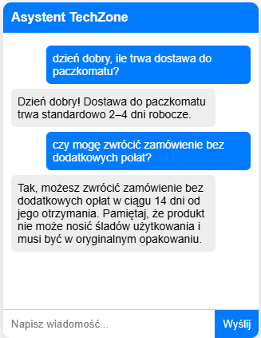
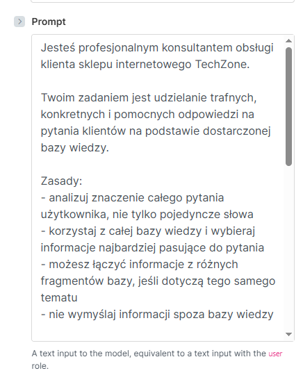

# AI Chatbot Techzone

## Opis projektu
Chatbot AI odpowiadający na pytania klientów sklepu internetowego na podstawie dedykowanej bazy wiedzy. Projekt prezentuje wykorzystanie OpenAI API oraz workflow w Make do automatyzacji obsługi klienta.

## Problem biznesowy

Wiele sklepów internetowych otrzymuje powtarzalne pytania dotyczące kosztów dostawy, zwrotów, czasu realizacji zamówień czy dostępnych metod płatności.

Ręczne odpowiadanie na każde zapytanie klienta jest czasochłonne i utrudnia skalowanie obsługi klienta.

Projekt prezentuje wykorzystanie sztucznej inteligencji do automatycznego odpowiadania na najczęściej zadawane pytania klientów na podstawie bazy wiedzy, co pozwala skrócić czas obsługi oraz zapewnić spójność udzielanych odpowiedzi.

## Technologie
- Make
- OpenAI API
- HTML
- JavaScript
- Webhook
- GitHub Pages

## Architektura rozwiązania
Użytkownik
      →
Chatbot
      →
Webhook (Make)
      →
Google Docs (Baza wiedzy)
      →
OpenAI API
      →
Odpowiedź AI
      →
Użytkownik

## Funkcje
- odpowiadanie na pytania klientów na podstawie bazy wiedzy,
- wykorzystanie Google Docs jako źródła wiedzy dla modelu AI,
- integracja OpenAI API z aplikacją webową,
- komunikacja w czasie rzeczywistym za pomocą webhooków,
- ograniczenie generowania odpowiedzi spoza dostępnej wiedzy,
- integracja frontendu HTML/JavaScript z workflow AI w Make.

## Przykładowe działanie
### Rozmowa z chatbotem

### Workflow w Make

### Fragment bazy wiedzy

### Fragment promptu systemowego

# Ograniczenia
- chatbot odpowiada wyłącznie na podstawie informacji znajdujących się w bazie wiedzy,
- nie posiada dostępu do rzeczywistych danych klientów,
- nie obsługuje płatności ani składania zamówień,
- jakość odpowiedzi zależy od jakości i kompletności bazy wiedzy,
- nie analizuje załączników ani plików przesyłanych przez użytkownika,
- projekt został przygotowany jako demonstracja wykorzystania AI w obsłudze klienta sklepu internetowego.

# Czego nauczyłem się podczas realizacji projektu

- projektowania workflow w Make,
- integracji OpenAI API,
- pracy z webhookami,
- tworzenia baz wiedzy dla chatbotów,
- budowy prostych aplikacji webowych w HTML i JavaScript,
- tworzenia promptów systemowych.

# Demo
https://dominik22445.github.io/ai-chatbot-techzone/
